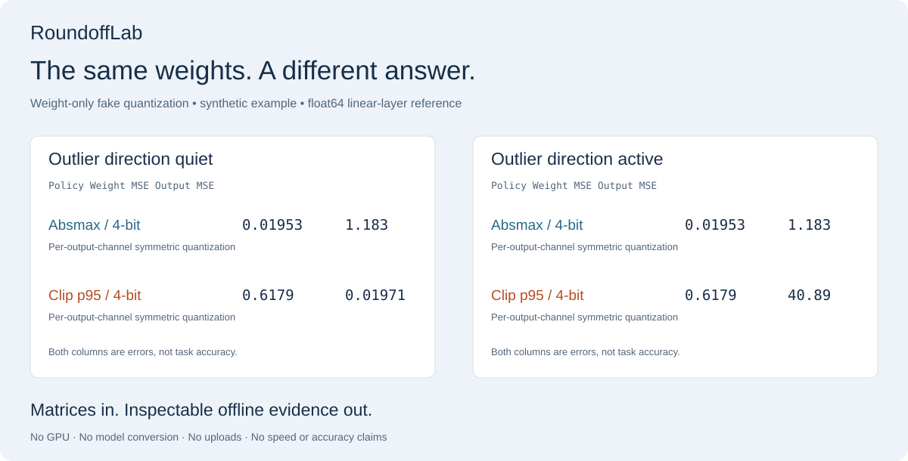

# RoundoffLab

**Smaller weight error does not always mean smaller output error.**

Compare weight-only quantization policies on your own matrices, inspect which output channels change, and share the evidence as a single offline HTML file. No GPU, model conversion, API key or server.

[Try the interactive example](https://gedouluhui.github.io/roundoff-lab/) · [中文说明](README.zh-CN.md) · [Numerical contract](docs/DESIGN.md)

[](https://github.com/gedouluhui/roundoff-lab/actions/workflows/ci.yml)
[](LICENSE)



## New: discovery-frozen candidate validation (0.2 alpha)

This branch contains **0.2.0a1**, a local candidate build. The hosted link above is the released v0.1 demo until the coordinating maintainer publishes this upgrade. Existing `analyze`/`demo` commands and schema-1 JSON remain supported.

Bring already-dequantized weights from your quantizer, or combine them with RoundoffLab simulations. Pick using **discovery** inputs; inspect the fixed candidate on separately supplied **validation** inputs. The report keeps its selection fixed while switching cohort views. No checkpoint loading or model conversion is added.

```sh
python -m pip install .
python examples/build_study.py --out candidate-study
```

Open `candidate-study/index.html`. This synthetic counterexample selects a clipped candidate on discovery, then shows it losing on validation. Both candidate files were generated by this example using RoundoffLab; they are not advertised as third-party model results.

For your own data, put candidate file paths in `candidates.json`:

```json
{"export-a": "exports/weights-a.npy", "export-b": "exports/weights-b.npy"}
```

```sh
python -m roundofflab study --weights weights.npy --discovery discovery.npy --validation validation.npy --candidates candidates.json --out study-result
```

Relative candidate paths resolve from the manifest directory. Matrices must have the same `[out,in]` layout as the original W and must **already be dequantized**; no second quantization is performed. The report calls these **user-declared external candidates**, not verified GPTQ/AWQ models. Scale counts, clipping counts and bit widths remain unknown rather than being invented. Fingerprints cannot establish semantic coordinate alignment.

By default the choice minimizes discovery **propagated MSE**, with ID order breaking exact ties. `--selected external:export-a` honors an already chosen candidate; `--selection-metric output_mse` explicitly selects using observed forward error instead. Validation never selects the candidate. Different files/fingerprints do not prove independent sampling, and repeated tuning after viewing validation reuses that data. Identical numeric cohorts receive an additional reuse warning; absence of that warning does not certify no overlap.

### Why two output-error measurements?

| Measurement | Meaning |
|---|---|
| Observed output MSE | Difference between two separately rounded float64 forwards: `X @ Wq.T - X @ W.T` |
| Propagated MSE | Direct float64 propagation of the weight difference: `X @ (Wq-W).T` |

For `W=[[1, 0.1]]`, `Wq=[[1, 0]]`, `X=[[1e16, 1]]`, the two forward results can round to the same number. Observed MSE is zero while propagated MSE is `0.01`. The study reports both, flags this zero-masking condition, and never claims either is arbitrary-precision truth or deployment-kernel error. Worst-sample evidence identifies zero-based row/channel coordinates for propagated error without embedding raw activations.

The new study uses fixed row-wise matrix-vector contractions and ordered scaled-squares accumulation. `--batch-rows` controls temporary output storage, **not the arithmetic path**. This prioritizes reproducible selection across batch sizes over bulk-BLAS throughput; no speedup is claimed. Total input/candidate elements and each cohort's logical outputs retain explicit work guards.

The [`study()` Python API](docs/VALIDATION_STUDY.md) returns a schema-2 bundle; `render_report()` accepts both schemas. Example:

```python
from roundofflab import study, render_report
report = study(w, discovery, validation,
               candidates={"export-a": candidate_a, "export-b": candidate_b},
               batch_rows=64)
```

With PyTorch already installed, `python examples/pytorch_export.py --out torch-example` exercises a **real quantized tensor's `dequantize()`** and a deliberately wrong export omitting its zero point. The data is synthetic; it does not test pretrained models, activation quantization or deployed kernels. Torch is not installed by RoundoffLab and is not a runtime dependency. The optional integration test is explicitly skipped when unavailable.

## A small example with a real consequence

A weight matrix has one unusually large input-channel column. That column widens an absmax quantizer's scale. If your inputs barely excite that direction, clipping its weights can increase **weight MSE** while decreasing **output MSE**. Activate the same direction and the trade-off changes.

The included `quiet-outlier` and `active-outlier` examples use the **same synthetic weights** and different inputs. The report computes their results; it does not hardcode a ranking. This is an intentionally constructed counterexample, not a pretrained-model benchmark or a recommendation to clip real models.

## Run in a minute

Python 3.10+ and NumPy. Install into your preferred virtual environment:

```sh
git clone https://github.com/gedouluhui/roundoff-lab.git
cd roundoff-lab
python -m pip install .
python -m roundofflab demo --out demo-quiet
python -m roundofflab demo --scenario active-outlier --out demo-active
```

Open `demo-quiet/report.html` and `demo-active/report.html` in a browser. They work offline and include:

- A weight-error vs output-error ranking diagram and complete comparison table.
- Selectable policies, an aggregated weight-error heatmap and per-output-channel errors.
- The numerical policy, input fingerprints and downloadable JSON.

The demo also writes `weights.npy` and `inputs.npy`, so you can rerun analysis independently. Existing outputs are protected; use another directory or explicitly pass `--force`. `roundofflab` is also installed as a console command. GitHub releases provide wheels and source distributions; **this is not currently a PyPI installation instruction**.

## Bring your own layer

Export a weight matrix `W[out, in]` and representative inputs `X[samples, in]` as individual `.npy` files. Only finite, nonempty 2D float32/float64 matrices are accepted. For a PyTorch linear layer, for example:

```python
import numpy as np

np.save("weights.npy", layer.weight.detach().cpu().float().numpy(), allow_pickle=False)
np.save("inputs.npy", inputs.detach().cpu().float().numpy().reshape(-1, layer.in_features), allow_pickle=False)
```

The tool computes the **bias-free linear contribution**; it does not inspect a whole model or add a layer's bias.

```sh
python -m roundofflab analyze --weights weights.npy --inputs inputs.npy --out my-report
```

Use an explicit JSON configuration array to compare particular policies:

```json
[
  {"bits": 4, "mode": "tensor"},
  {"bits": 4, "mode": "channel"},
  {"bits": 4, "mode": "group", "group_size": 128},
  {"bits": 4, "mode": "channel", "percentile": 99},
  {"bits": 8, "mode": "channel"}
]
```

Save it as `policies.json`, then append `--configs policies.json`. Bits 2–8 are supported. Groups follow the input axis within each output row; a short final group is included. Percentiles are computed over absolute weights in each scale unit, **not** over inputs and not by a calibration search.

### Python API

```python
from pathlib import Path
import numpy as np
from roundofflab import Config, analyze, render_report

w = np.load("weights.npy", allow_pickle=False)
x = np.load("inputs.npy", allow_pickle=False)
report = analyze(w, x, [Config(bits=4), Config(bits=4, percentile=99)])
Path("comparison.html").write_text(render_report(report), encoding="utf-8")
```

The API returns an ordinary JSON-compatible dictionary. The default report includes no raw matrices, but summaries and fingerprints may still be sensitive; inspect them before sharing.

## Precisely what is measured

| Quantity | Definition |
|---|---|
| Reference | `Y = X @ W.T` in float64 |
| Quantized output | `Yq = X @ Q(W).T` in float64 |
| Weight MSE | Mean of `(Q(W) - W)**2` |
| Output MSE | Mean of `(Yq - Y)**2` on the supplied inputs |
| Relative output L2 | `||Yq-Y|| / ||Y||`; null when `||Y|| = 0` |
| Clipped weights | Count of original absolute weights strictly above the per-unit threshold |
| Ranking reversal | Strictly smaller weight MSE but strictly larger output MSE between two policies |

Symmetric narrow-range codes use `[-(2**(bits-1)-1), +(2**(bits-1)-1)]`, i.e. **[-7, 7]**, not [-8, 7], for 4 bits. Rounding is ties-to-even. Zero thresholds produce zero dequantized values. Read the [full contract](docs/DESIGN.md) for grouping, fingerprints and arithmetic rejection behavior.

The heatmap shows a tile mean at up to 24 × 64 tiles. Click to inspect exact half-open index bounds. A large bright tile is not a proven causal explanation of output error. Different scale counts and bit widths are visible, but are **not deployment memory estimates**.

## What it is not

This is a small diagnostic and teaching instrument, not a model quantizer, GPU kernel, inference benchmark, task-accuracy evaluator, security scanner or novel quantization method. We do not claim lower perplexity, faster inference or a universally best policy. No activation quantization, asymmetric zero points, biases, GPTQ/AWQ optimization or checkpoint loading is implemented.

Defaults guard 4 million aggregate input elements, 4 million output elements, 24 policies and 4096 output channels. The element limits are adjustable with CLI flags; they are work-size guards, **not a peak-RSS or runtime guarantee**. Overflow and unrepresentable squared-error metrics are rejected. BLAS/platform differences can affect final floating-point bits. Use smaller representative slices for large layers, and independent held-out inputs before drawing broader conclusions.

The reader uses read-only NumPy memory mapping with `allow_pickle=False`. Nothing is uploaded and no model code is executed. Do not run multiple writers into one output directory. New files are staged; previous artifacts are backed up before publication. Ordinary write failures roll back. If rollback itself fails, the error points to retained backups. Publication requires filesystem hard-link support (Windows and Linux are CI targets); this is **not a crash-atomic multi-file transaction**. After process termination or power loss, regenerate into a fresh directory.

## Use the right tool

- [ONNX Runtime quantization debugging](https://onnxruntime.ai/docs/performance/model-optimizations/quantization.html) already matches weights and activations between original and quantized ONNX models. Use it for graph-level debugging and deployment workflows.
- [LiteRT Quantization Debugger](https://developers.google.com/edge/litert/models/quantization_debugger) provides model/layer debugging within its conversion workflow.
- [GPTQ](https://arxiv.org/abs/2210.17323) optimizes a layer-output reconstruction objective. Output-aware quantization is not an idea introduced here.

RoundoffLab's narrower job is **matrices in, inspectable offline evidence out**, without adopting a model-conversion pipeline.

## Development and reproducibility

```sh
python -m pip install .
python -m unittest discover -s tests -v
python -m pip install build
python -m build
```

Tests include hand-calculated ties, a separate scalar quantization oracle, zero and tail groups, independent output arithmetic, isotropic-input ranking controls, real CLI round trips, overwrite protection and inert script-injection strings. Named mutations run only in disposable source copies and must be caught by their designated assertions, including validation-driven reselection, external-candidate re-quantization and conflation of the two error measurements. One optional JavaScript arithmetic regression requires Node.js (otherwise explicitly skipped); Node is not a runtime dependency. These tests establish their stated cases, not arbitrary-model correctness. The CI matrix covers Linux and Windows; see the actual workflow run rather than assuming every platform passed.

Please report a minimal W/X reproduction, policy configuration, package/NumPy versions, expected result and actual result. Do not attach private model weights or sensitive inputs. Small numerical counterexamples and clearer diagnostics are especially welcome; new quantization families should come with an explicit contract and independent reference.

MIT licensed. Developed with AI assistance; numerical definitions, tests and limitations are open for inspection. No external-user adoption or model-quality improvement is claimed.
